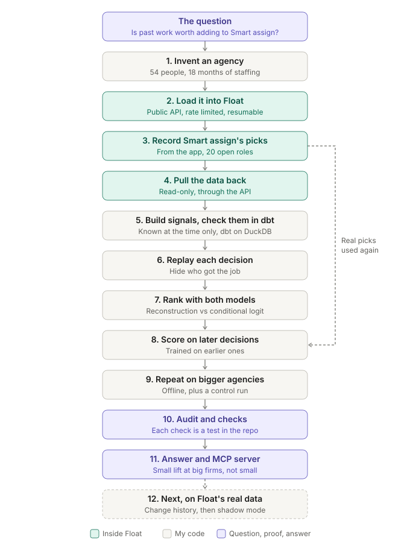
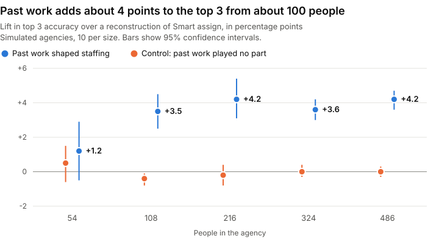

# float-staffing-backtest

Experience-aware staffing recommendations for [Float](https://www.float.com), backtested against a reconstruction of Float's Smart assign. Two-page write-up: [Experience-aware staffing for Float (PDF)](https://v391.github.io/float-staffing-backtest/docs/Experience-aware-staffing-for-Float.pdf).

**Detailed methodology:** [Step-by-step methodology and technical implementation](docs/METHODOLOGY.md), including data generation, decision labels, candidate pools, feature engineering, conditional logistic regression, temporal backtesting, validation, and limitations.

Smart assign ranks people by job title and availability ([help article](https://support.float.com/en/articles/13868430-role-based-planning-smart-assign)), so for a given role it suggests the same people whatever the client. This repo adds past work as a signal (same client, similar projects, skills) and measures whether that picks the person a manager actually chose.

**Result: from about 100 people, past work adds about 4 points to top 3 accuracy and 2 to 5 points to first pick. At 54 people it adds nothing measurable.** The effect steps up once, then stays flat. The staffing history is invented, so this shows a direction, not Float customer accuracy.



## Results



**By agency size.** 10 simulated agencies per size, run offline. "From past work" is the main run's lift minus the control's lift, paired by seed, with a 95% confidence interval. Numbers are in [docs/sweep-results.json](docs/sweep-results.json).

Top 3:

| People | Title and availability | With past work | Lift | Control lift | From past work (95% CI) |
| --- | --- | --- | --- | --- | --- |
| 54 | 68.9% | 70.1% | +1.2 | +0.5 | +0.7 (-0.8 to 2.3) |
| 108 | 55.5% | 59.0% | +3.5 | -0.4 | +3.9 (2.9 to 5.0) |
| 216 | 42.4% | 46.6% | +4.2 | -0.2 | +4.4 (3.6 to 5.3) |
| 324 | 35.9% | 39.5% | +3.6 | 0.0 | +3.6 (3.0 to 4.2) |
| 486 | 29.3% | 33.4% | +4.2 | 0.0 | +4.1 (3.5 to 4.8) |

First pick:

| People | Title and availability | With past work | Lift | Control lift | From past work (95% CI) |
| --- | --- | --- | --- | --- | --- |
| 54 | 39.1% | 39.7% | +0.7 | -0.2 | +0.9 (-1.5 to 3.3) |
| 108 | 27.9% | 30.7% | +2.8 | -0.6 | +3.3 (1.8 to 4.9) |
| 216 | 19.6% | 23.4% | +3.9 | -0.7 | +4.6 (3.7 to 5.5) |
| 324 | 16.5% | 18.9% | +2.3 | 0.0 | +2.3 (1.2 to 3.5) |
| 486 | 12.5% | 15.1% | +2.6 | +0.1 | +2.5 (1.8 to 3.3) |

**Control.** Agencies where past work plays no part in staffing (`--staffing=title`, same people and projects). The model gives client history about zero weight (-0.01 to 0.03, against 0.15 to 0.23 in the main run) and its lift falls to about zero. This shows the model doesn't invent an effect. It can't show that real managers behave this way.

**Noise check.** The main runs use Gumbel noise, which is exactly what a logit assumes. With normal noise the top 3 lift from past work did not shrink: +4.1 (3.2 to 5.1) at 108 people and +6.1 (4.8 to 7.4) at 216.

**The 54-person agency inside a Float Pro trial.** 205 held-out decisions after Feb 2026. One agency is too small a sample to separate these gaps from noise, so this run shows the pipeline works through Float. The sweep carries the evidence.

| Ranker | Top 3 | First pick |
| --- | --- | --- |
| Reconstruction of Smart assign | 66.5% | 33.1% |
| Experience model | 67.8% | 36.6% |

**Against Float's real Smart assign on 20 live open roles** (recorded in the app, `data/smart-assign-capture.csv`):

| Ranker | Top 3 | First pick |
| --- | --- | --- |
| Smart assign (real) | 15/20 | 9/20 |
| Reconstruction of it | 13/20 | 7/20 |
| Experience model | 15/20 | 9/20 |

That is a tie, and 20 roles wouldn't prove a win anyway. The reconstruction matched Smart assign's first pick on 15/20. It is built from the help docs, not Float's code, and it is weaker than the real thing, which could flatter the lift in the sweep.

## Audit and checks

I audited the evaluation in November 2026 and wrote each check into the repo as a test. Each one was confirmed to fail when the behaviour it guards is broken on purpose. These numbers replace the October ones, which predate the tie and finished team rules below.

| Check | What it guards | Where |
| --- | --- | --- |
| Ties are scored fairly | A ranker that can't separate people scores at chance, not zero. Title and availability ties on 12% of decisions at 54 people and 66% at 486 | `tests/audit.test.ts` |
| The baseline stays honest | The Smart assign reconstruction uses title and availability only | `tests/audit.test.ts` |
| Later work changes nothing | Work starting on or after the decision date moves no signal | `tests/audit.test.ts` |
| The finished team is invisible | A replay is identical whoever ended up on the team | `tests/audit.test.ts`, `assert_pool_ignores_finished_team` |
| Recent work counts for more | Client history decays over time | `tests/audit.test.ts` |
| The model doesn't invent an effect | History gets weight only when it really drove the choice | `tests/audit.test.ts`, control sweep |
| History dates are clean | No signal uses a project that hadn't started | `assert_no_feature_leakage` |
| Every pick is in its pool | The person chosen could have been recommended | `assert_chosen_person_in_pool` |
| SQL matches TypeScript | Both builds of the signals agree | `assert_ts_sql_feature_parity` |

## Known limitations

- The agency is synthetic and the staffing rules are mine. Only the 54-person agency went through Float itself.
- Real allocations show the final booking, not what was known when it was made. A fair replay on real data needs change history.
- Small leaks remain: TF-IDF weights use all projects, the pool knows if someone later leaves, and time off isn't dated by when it was booked.
- `assert_ts_sql_feature_parity` compares candidate pools, same client count, skill matches, booked hours and the chosen flag. It does not compare title fit, availability, tag overlap or text similarity.

## How it works

```
src/world.ts      generate a fictional agency + 18 months of staffing (seeded)
src/load.ts       load it into Float through the public API (resumable, rate limited)
src/pull.ts       read it back out, read-only -> out/float-export.json
src/features.ts   6 signals per candidate, using what was known at decision time
src/models.ts     reconstruction of Smart assign + experience model (conditional logit)
src/backtest.ts   replay every decision, train before 2026-02-01, test after
src/mcp.ts        MCP server: recommend_people, recommend_for_brief, list_open_roles
scripts/sweep.mjs size sweep and control, 140 runs in parallel, offline
warehouse/        dbt (DuckDB) rebuild of the features in SQL, with tests
```

The dbt project models the raw export into staging, intermediate and mart layers and tests it: keys and relationships, history dates before each decision (`assert_no_feature_leakage`), every actual pick in its candidate pool, and SQL against TypeScript on 18,266 candidate rows (`assert_ts_sql_feature_parity`, scope above). DuckDB stands in for BigQuery.

## Run it

Needs Node 22+, and Python 3.11+ for the dbt part.

```bash
npm install
npm run world                 # generate the agency
cp .env.example .env          # add a Float API token and contact email
npm run ping                  # read-only: token works, account is empty
npm run load                  # ~20 min at Float's rate limit
npm run pull                  # read it back
npm run backtest              # results -> out/backtest.json
```

Without a Float account, the same backtest runs on a simulated export:

```bash
npx tsx src/simexport.ts --in=out/world.json --out=out/float-export.json
npm run backtest -- --no-live
```

Size sweep, control and chart:

```bash
npm run sweep                 # 140 runs, finished ones are kept, so it can resume
npx tsx src/sweep-summary.ts  # print the tables, write out/sweep.json
node scripts/build-chart.mjs  # redraw docs/lift-by-size.svg
```

dbt:

```bash
python -m venv .venv && .venv/Scripts/pip install -r warehouse/requirements.txt
npm run warehouse             # dumps TS features, then dbt build (models + tests, 47 steps)
```

`npm run cleanup -- --yes` deletes from Float exactly what `load` created, nothing else.

`npm test` typechecks and runs the 13 unit tests in `tests/`: the ranking logic in `ranking.test.ts` and the audit checks in `audit.test.ts`. The dbt tests cover the data layer.

## Evidence, not just results

- `data/smart-assign-capture.csv`: Smart assign's actual top 3 for 20 open roles, recorded in the Float app on 17 Oct 2026. The reconstruction is checked against this, not only against my reading of the docs.
- `docs/sweep-results.json`: every number in the size tables.
- `out/backtest.json` (after a run): decision counts, candidate pool size, learned weights, and the live comparison row by row.
- Loading is resumable: `out/manifest.json` records every Float id created, so an interrupted load continues instead of duplicating, and cleanup removes exactly those ids.

## How I used Claude Code

Most of the code was first drafted with Claude Code and then reworked. The parts that mattered, I designed and checked myself: the staffing rule behind the synthetic agency, the decision to replay history as of each project's start date, the control run that tests whether the model invents an effect, and reading Smart assign's live picks against the baseline. Things I rejected or rewrote along the way: a Python Timefold path (the binding was archived in 2025), retrying writes on 5xx (a POST may already have applied), and a first version of the results that claimed the lift "doubles". The November audit was also AI assisted, and I checked its findings by rerunning them. The commits carry a co-author line because that is what happened.

## MCP

`npm run mcp` starts a stdio MCP server over the pulled data. Register it with Claude Code or Claude Desktop as `node --import tsx src/mcp.ts` from this folder. Ask it things like "who should be Senior Designer on KST-P083?" or "who fits an Art Director role for a new Stride Athletics campaign in January?"

Smart assign's own suggestions are not exposed by Float's public API or Float MCP, which is why they were recorded from the app.
